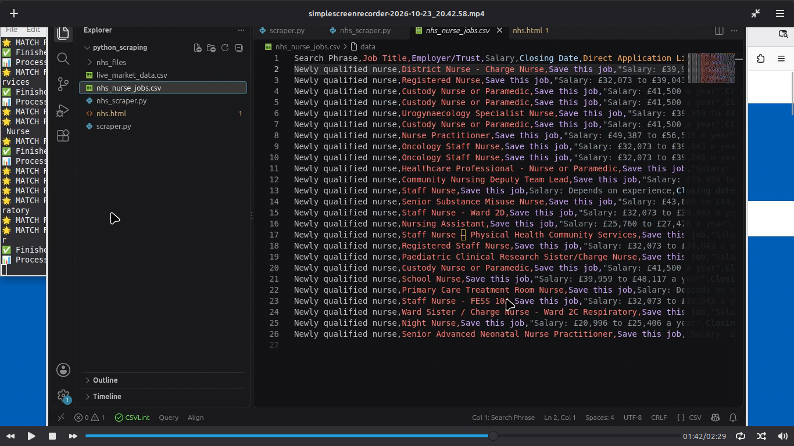
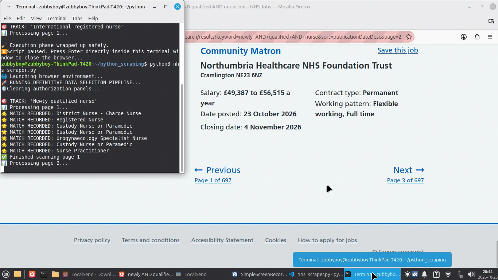
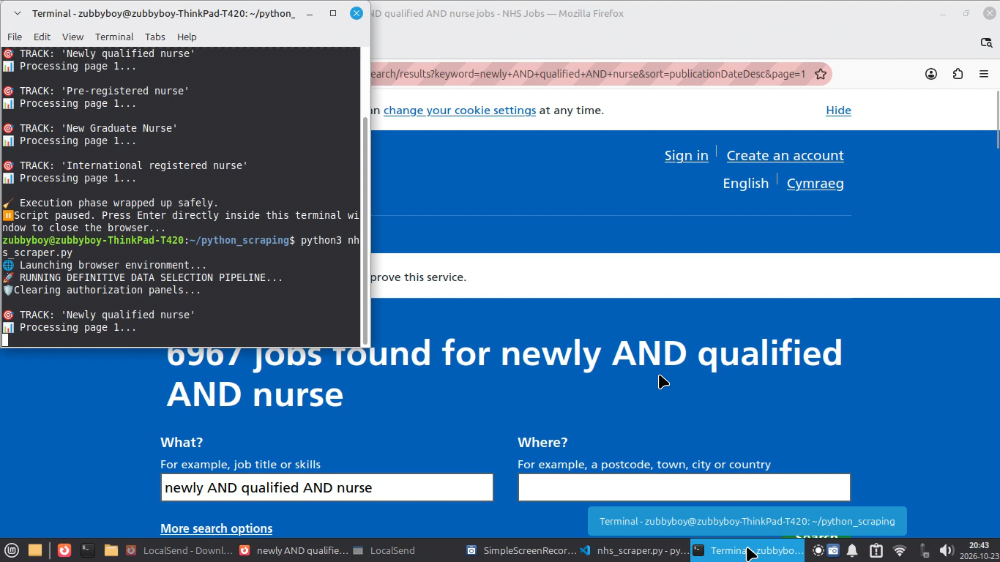

# NHS Band 5 Job Tracking Pipeline for UK Staffing Agencies

> **For UK Healthcare Recruiters:** Stop checking beta.jobs.nhs.uk manually. This pipeline automates it.

Automated job monitoring system built to help UK staffing agencies track Band 5 nursing vacancies and match candidates faster.

### 1. CSV Output - Ready for ATS Import

*26 Newly Qualified roles captured: Job Title, Trust, Salary, Closing Date, Direct Link - from VS Code*

### 2. Live Website Scanning

*Live scraping beta.jobs.nhs.uk - Community Matron £48k+ captured + Terminal showing MATCH RECORDED*

### 3. Terminal Execution Engine

*Python + Selenium processing 4 tracks: 'Newly qualified nurse', 'Pre-registered nurse', 'New Graduate Nurse', 'International registered nurse'*

## Why Agencies Use This

**Problem:** UK agencies spend 10+ hrs/week manually searching NHS Jobs for newly qualified roles.

**Solution:** Automated weekly scan that delivers ready-to-use CSV for candidate matching.

## Target Roles Filter

- ✅ INCLUDE: Newly Qualified Nurse / Pre-registered Nurse / Band 5 Nurse
- ❌ EXCLUDE: Senior, Sister, Matron, Manager, Lead roles (Smart filter)

## Output

`nhs_nurse_jobs.csv` - 26+ jobs with Title, Employer, Trust, Salary, Closing Date, Direct Application Link

## Tech Stack

Python, Selenium WebDriver, Firefox, VS Code

## Quick Start
```bash
pip install selenium
python nhs_scraper.py
## Built by Francis Automation

I build custom sourcing automations for UK agencies.

**Services:** NHS Job Pipeline | Talent Sourcing | Lead Generation Automation

**Contact:** GitHub @Francis-Automation | LinkedIn - Francis Automation

**For Agencies:** DM me on LinkedIn to automate your NHS Jobs sourcing.
